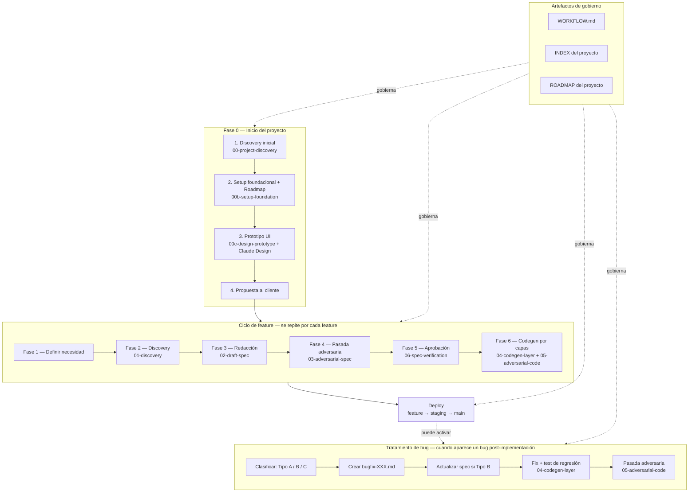

# Vista general del proceso SDD

> **Toolkit:** sdd-toolkit
> **Versión:** 20261101-v5
> **Propósito:** Vista rápida del proceso completo del toolkit SDD. Para detalle visual completo, ver [`process-diagram.svg`](./process-diagram.svg).

---

## Diagrama del proceso

---

## Lectura rápida

**Fase 0** se hace una sola vez por proyecto. Produce el setup foundacional, el roadmap y el prototipo UI.

**Ciclo de feature** se repite por cada feature listada en el roadmap. Tiene 6 fases secuenciales con prompts asociados. **Desde WORKFLOW v19 se ejecuta en Modo Flow** con `/sdd-feature`: las fases 2+3 se fusionan (spec-first, `08-spec-first`), la 4 y la verificación corren en un solo subagente, y la 6 genera todas las capas con un plan único y una sola revisión de código; el autor interviene en los gates del track (preguntas en lote, aprobación de spec, plan, prueba manual). **Desde WORKFLOW v20 todo trabajo (feature nueva o modificación) se clasifica por riesgo en un track — Rápido, Estándar o Completo — que decide cuántos gates (2, 3 o 4) y qué revisiones corren; la revisión adversaria de spec aplica solo en Estándar y Completo.** El diagrama muestra el modelo conceptual por fases, que no cambia.

**Deploy** ocurre después de completar Fase 6. Sigue el modelo de ramas definido en WORKFLOW sección 11.6.

**Artefactos de gobierno** son transversales: aplican a todo el proceso.

---

## Para detalle completo

El diagrama Mermaid de arriba muestra el esqueleto del proceso. Para ver el detalle visual completo con todos los artefactos, prompts, templates, inputs y outputs:

- [`process-diagram.svg`](./process-diagram.svg) — mapa detallado (WORKFLOW v20): tracks, gates, prompts por paso, artefactos producidos, gobierno e inventario.
- [`flow_ciclo_feature.svg`](./flow_ciclo_feature.svg) y [`flow_codegen_y_deploy.svg`](./flow_codegen_y_deploy.svg) — flujo paso a paso del Modo Flow y de Fase 6 + deploy.
- Los tres se generan con `python docs/_build_diagrams.py` (editar el script, no el SVG).

---

## Inventario del toolkit

El toolkit está organizado en:

- **1 workflow:** `WORKFLOW.md`
- **11 prompts:** 3 de Fase 0 + 8 del ciclo de feature (incluye `07-modify-spec` y `08-spec-first`)
- **13 templates:** setup foundacional (6) + spec de feature (2) + proyecto (2) + ADR (1) + design system (1) + bugfix (1)
- **2 protocolos:** codegen-protocol, track-routing
- **6 documentos:** process-overview, process-diagram.svg, 3 diagramas de flujo SVG, artifacts-usage-guide
- **1 plugin de Claude Code:** `.claude-plugin/` + `commands/` (un comando por fase del proceso)

> Nota: el conteo total de artefactos quedó pendiente de recuento (el número anterior ya no cuadraba con el desglose). Revisar al consolidar.

Para listado completo y referencia rápida, ver `docs/artifacts-usage-guide.md`.

---

## Changelog

| Versión | Fecha | Cambios |
|---------|-------|---------|
| 20260523-v1 | 2026-05-23 | Versión inicial. |
| 20260526-v2 | 2026-05-26 | Agregado flujo de tratamiento de bugs al diagrama mermaid. Corregida referencia sección 9.6 → 11.6. Actualizado inventario: 23 → 26 artefactos con desglose correcto. |
| 20260602-v3 | 2026-06-02 | Inventario actualizado por WORKFLOW v10: 10 prompts (agregado `07-modify-spec`), agregado el plugin de Claude Code. Removido el total exacto de artefactos (ya no cuadraba con el desglose) y marcado para recuento. Pendiente: regenerar `process-diagram.svg` (sigue mostrando conteos viejos). |
| 20261101-v4 | 2026-11-01 | WORKFLOW v19 (Modo Flow): nota en "Lectura rápida" sobre la ejecución con `/sdd-feature` y sus 4 gates; inventario a 11 prompts (`08-spec-first`) y 2 protocolos. Pendiente: regenerar `process-diagram.svg` y los SVG de flujo. |
| 20261101-v5 | 2026-11-01 | WORKFLOW v20: nota en "Lectura rápida" sobre los tracks Rápido / Estándar / Completo (reemplazan tiers y tamaños S/M/L); inventario de protocolos: `tier-routing` → `track-routing`. Pendiente: regenerar `process-diagram.svg` y los SVG de flujo. |
